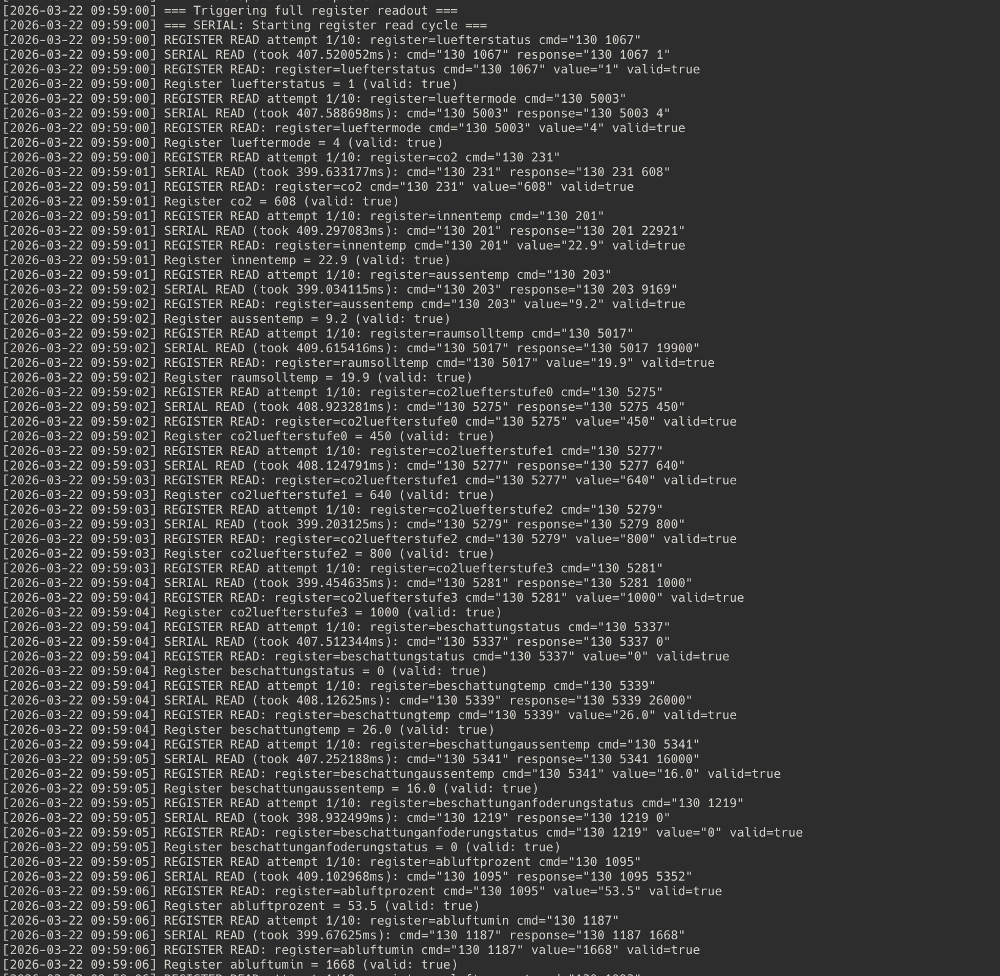
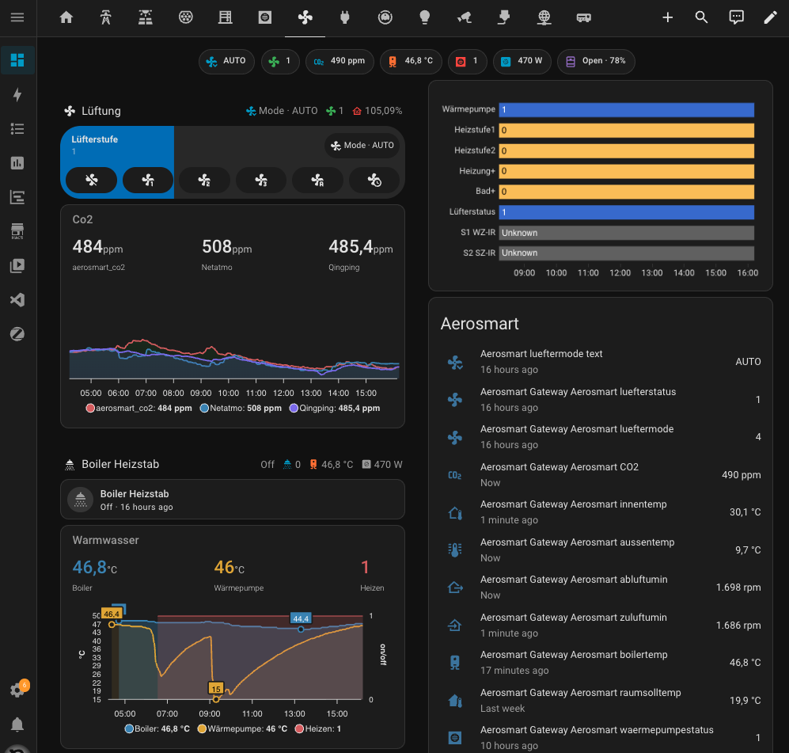

# Aerosmart Gateway

A Go-based gateway application that communicates with Drexel&Weiss Aerosmart M ventilation/heatpump devices via USB serial and integrates with Home Assistant via MQTT.

> **⚠️ Disclaimer:** This software is provided "as is", without warranty of any kind. Use at your own risk. The authors accept no liability for any damages, data loss, or device malfunctions resulting from the use of this software. This project is not affiliated with or endorsed by Drexel und Weiss.

## Features

- **Serial Communication**: Reads and writes to Aerosmart M device via serial over [USB located on Mainboard - refer to INSTALLATION.md](docs/INSTALLATION.md). NOTE: It is **NOT** Modbus RTU, no modbus settings required.
- **MQTT Integration**: Publishes sensor data and subscribes to control commands
- **MQTT Resilience**:
  - **Persistent Session**: Subscriptions preserved across reconnects (CleanSession=false)
  - **Auto-Recovery**: Automatically re-subscribes to topics after connection loss
  - **Configurable QoS**: Supports QoS 0, 1, or 2 (default: 1 for at-least-once delivery)
  - **KeepAlive Monitoring**: Detects network failures within 30-60 seconds
  - **Connection State Visibility**: Logs reconnection progress and state changes
  - **Publish Retry**: Automatic retry with exponential backoff for failed publishes
- **Home Assistant Discovery**: Auto-discovers sensors and switches in Home Assistant
- **Derived Calculations**: Calculates derived values (e.g., zuluftabluftprozent, co2luefterstufe4)
- **Configurable Logging**: Supports debug, info, warn, and error log levels
- **Graceful Shutdown**: Handles SIGINT and SIGTERM signals for clean shutdown
- **Reconnection**: Automatic reconnection for both serial and MQTT connections
- **Write Priority**: Control commands preempt ongoing read operations for low-latency response (<1 second detection, 1-3 second write completion). Write priority auto-expires after 10 seconds to prevent blocking on serial errors.
- **Message Deduplication**: Prevents processing duplicate MQTT messages within 1 second window
- **Timing Metrics**: Logs message processing latency (receive → process → complete) for monitoring

## Architecture

The application follows a layered architecture with the following main components:

```
┌─────────────────────────────────────────────────────────────────┐
│                        main.go                                  │
│  - Initialization & Configuration                               │
│  - Connection Management                                        │
│  - Main Loop (Periodic Reads)                                   │
└─────────────────────────────────────────────────────────────────┘
        │                     │                     │
        ▼                     ▼                     ▼
┌───────────────┐   ┌─────────────────┐   ┌───────────────┐
│   serial/     │   │    mqtt/        │   │   registers/  │
│   serial.go   │   │    client.go    │   │   reader.go   │
│               │   │                 │   │               │
│ - Open/Close  │   │ - Connect       │   │ - ReadSingle  │
│ - Write       │   │ - Publish       │   │ - ReadAll     │
│ - Read        │   │ - Subscribe     │   │ - PublishAll  │
│ - SendAnd     │   │ - Discovery     │   │               │
│   Receive     │   │                 │   │               │
└───────────────┘   └─────────────────┘   └───────────────┘
        │                     │                     │
        │                     │                     │
        └─────────────────────┼─────────────────────┘
                              ▼
                    ┌─────────────────┐
                    │   registers/    │
                    │   reader.go     │
                    │   (Writer)      │
                    │ - HandleMessage │
                    │ - TriggerFull   │
                    └─────────────────┘
```

### Component Flow

1. **Serial Port** (`internal/serial/serial.go`): Handles all serial communication with the device, including retry logic and port management
2. **MQTT Client** (`internal/mqtt/client.go`): Manages MQTT connections, publishing, and subscriptions
3. **Register Reader** (`internal/registers/reader.go`): Reads register values from the device and publishes to MQTT
4. **Register Writer** (`internal/registers/reader.go`): Handles write commands from MQTT and verifies after writing

## Quick Start

### Prerequisites

- Go 1.25 or later
- A serial device connected to your Aerosmart M ventilation system
- MQTT broker (e.g., Mosquitto)

### Installation

```bash
# Clone the repository
git clone https://github.com/nean/aerosmart-gateway.git
cd aerosmart-gateway

# Build the application
go build -o aerosmart-gateway ./cmd/main.go
```

### Configuration

1. Copy the example configuration file:

```bash
cp config/config.yaml.example config.yaml
```

2. Edit `config.yaml` with your settings:

```yaml
serial:
  port: "/dev/ttyUSB0"
  baudrate: 115200
  # Rounded up to a multiple of 100ms (kernel VTIME granularity)
  read_timeout: 200
  response_timeout: 300
  retries: 3

mqtt:
  broker: "192.168.1.20"
  port: 1883
  username: "mqtt"
  password: "your_password"
  client_id: "aerosmart-gateway"
  # Home Assistant marks entities unavailable when this says "offline"
  availability_topic: "aerosmart/status"

device_id: "aerosmart"
log_level: "info"
read_interval: 120

ha_discovery:
  enabled: true
  prefix: "homeassistant"
  # Seconds without an update before an entity is shown unavailable
  # rather than displaying a stale retained value
  expire_after: 300
  device_info:
    name: "Aerosmart Gateway"
    manufacturer: "Drexel und Weiss"
    model: "aerosmartPI"
    # sw_version: defaults to the application version if not set
```

Validate a configuration without starting the gateway:

```bash
./aerosmart-gateway -validate -config config.yaml -registers registers.yaml
```

### Running the Application

```bash
./aerosmart-gateway -config config.yaml -registers registers.yaml
```
Example of full register readout:


## Documentation

For detailed information about the application flow and timing diagrams, see:

- [Application Flow Analysis](docs/APPLICATION_FLOW.md) - Detailed analysis of the application flow
- [Timing Diagrams](docs/TIMING_DIAGRAMS.md) - Visual timing diagrams of component interactions
- [Installation Guide](docs/INSTALLATION.md) - Detailed setup instructions

## Command Line Options

| Option | Description | Default |
|--------|-------------|---------|
| `-config` | Path to config file | `config.yaml` |
| `-registers` | Path to registers file | `registers.yaml` |
| `-version` | Show version information | `false` |

## Configuration Options

### Serial Configuration

All timeouts are in milliseconds.

| Option | Description | Default |
|--------|-------------|---------|
| `serial.port` | Serial device path | `/dev/ttyUSB0` |
| `serial.baudrate` | Baud rate | `115200` |
| `serial.bytesize` | Data bits (5-8) | `8` |
| `serial.parity` | Parity: `N`, `O` or `E` | `N` |
| `serial.stopbits` | Stop bits (1 or 2) | `1` |
| `serial.read_timeout` | How long one read may block. The kernel expresses this as termios `VTIME` in deciseconds, so it is rounded up to a multiple of 100 | `200` |
| `serial.response_timeout` | Budget for one command/response exchange. Stale or unmatched frames are discarded within this window | `300` |
| `serial.retries` | Attempts per register operation. This is the only retry level in the stack | `3` |
| `serial.retry_backoff` | Delay between attempts | `100` |
| `serial.reopen_backoff` | Initial delay between port reopen attempts | `500` |
| `serial.reopen_max_backoff` | Maximum reopen delay | `30000` |
| `serial.health_check_interval` | How often port health is polled | `1000` |
| `serial.write_priority_timeout` | Upper bound on how long a write may hold reads off | `10000` |
| `serial.xonxoff` | Software flow control. **Not supported by the driver**; `true` is rejected at startup | `false` |
| `serial.dsrdtr` | Hardware flow control. **Not supported by the driver** | `false` |

Worst-case time for one register is
`retries x (response_timeout + read_timeout + retry_backoff)`, so with the defaults
3 x 600ms = 1.8s. The `read_timeout` term is there because an attempt can pass its response
deadline only after a read that has already started, and that read blocks for a full
`read_timeout`. Startup rejects a configuration whose worst-case full cycle (that figure
times the number of read registers) does not fit inside `read_interval`; with the shipped
29 registers that is 52.2s against a 120s interval.

Options from earlier versions (`max_retries`, `read_max_retries`, `write_max_retries`,
`device_response_delay`, `read_with_retry_delay`, `write_with_retry_delay`, `deadline_timeout`,
`max_reopens`, `timeout`, `write_timeout`, and the `serial.connect_retry_*` settings) are no
longer used. They are reported as warnings at startup rather than being silently ignored.

### MQTT Configuration

| Option | Description | Default |
|--------|-------------|---------|
| `mqtt.broker` | MQTT broker address | _(required)_ |
| `mqtt.port` | MQTT broker port | `1883` |
| `mqtt.username` | MQTT username | - |
| `mqtt.password` | MQTT password | - |
| `mqtt.client_id` | Client identifier | `aerosmart-gateway` |
| `mqtt.qos` | Quality of Service (0, 1, or 2) | `1` |
| `mqtt.retain` | Retain messages | `true` |
| `mqtt.publish_retry_count` | Number of retries for failed publishes | `3` |
| `mqtt.availability_topic` | Online/offline topic, also registered as the MQTT last will | `<device_id>/status` |
| `mqtt.op_timeout` | Bounds every broker interaction (ms). Publishes run on the serial read path, so an unbounded wait would stall polling | `5000` |
| `mqtt.connect_retry_initial_delay_ms` | Initial delay for exponential backoff | `500ms` |
| `mqtt.connect_retry_max_delay_ms` | Maximum delay for exponential backoff | `30000ms` |
| `mqtt.connect_retry_jitter_percent` | Jitter percentage for backoff | `25%` |

> **MQTT Resilience Note:** The gateway uses the configured QoS level (default: 1, at-least-once delivery) for subscriptions and publishes to ensure message reliability. Persistent sessions (CleanSession=false) preserve subscriptions across reconnects. KeepAlive is set to 30 seconds for fast disconnect detection.

### Application Configuration

| Option | Description | Default |
|--------|-------------|---------|
| `device_id` | Device identifier (used as HA identifiers) | `aerosmart` |
| `log_level` | Logging level | `info` |
| `read_interval` | Read interval (seconds) | `60` |
| `ha_discovery.enabled` | Enable HA discovery | `true` |
| `ha_discovery.prefix` | HA discovery topic prefix | `homeassistant` |
| `ha_discovery.device_info.name` | Device display name | `Aerosmart Gateway` |
| `ha_discovery.device_info.manufacturer` | Device manufacturer | `Drexel und Weiss` |
| `ha_discovery.device_info.model` | Device model | `aerosmartPI` |
| `ha_discovery.device_info.sw_version` | Software version (defaults to app version) | - |

## MQTT Topics

### Read Registers (Published)

The gateway publishes sensor values to the following topics:

- `aerosmart/luefterstatus` - Fan status (0-5)
- `aerosmart/lueftermode` - Fan mode (0-5)
- `aerosmart/co2` - CO2 level (ppm)
- `aerosmart/innentemp` - Indoor temperature (°C)
- `aerosmart/aussentemp` - Outdoor temperature (°C)
- `aerosmart/raumsolltemp` - Room setpoint temperature (°C)
- `aerosmart/zuluftumin` - Supply air RPM
- `aerosmart/abluftumin` - Exhaust air RPM
- `aerosmart/zuluftprozent` - Supply air percentage (%)
- `aerosmart/abluftprozent` - Exhaust air percentage (%)
- `aerosmart/zuluftsollvolumenstrom` - Supply air setpoint (m³/h)
- `aerosmart/abluftsollvolumenstrom` - Exhaust air setpoint (m³/h)
- And more... (see registers.yaml)

### Write Registers (Subscribed)

The gateway subscribes to the following topics for device control:

- `dw/aerosmart/luefterstufe` - Set fan stage (0-5) - *Topic changes detected and processed within 1-3 seconds*
- `dw/aerosmart/boilerheizstab` - Set boiler heating element (0-1) - *Topic changes detected and processed within 1-3 seconds*

> **Note:** The gateway implements immediate message detection with timestamp-based write priority signaling (auto-expires after 10 seconds), ensuring control commands are processed with minimal latency.

### Derived Registers

The gateway calculates and publishes derived values:

- `aerosmart/zuluftabluftprozent` - Supply/Exhaust percentage
- `aerosmart/co2luefterstufe4` - CO2 fan stage 4 (calculated from stage 3)
- `aerosmart/beschattungtemp_adjusted` - Adjusted shading temperature

## Home Assistant Integration

When `ha_discovery.enabled` is set to `true`, the gateway automatically publishes discovery configurations to Home Assistant. This creates:

- **Sensors**: For all read registers (temperature, CO2, fan speed, etc.)
- **Switches**: For write registers (fan stage, boiler heating element)

The devices will appear in Home Assistant with the name "Aerosmart Gateway".

Example of Home Assistant dashboard:



## Application Flow

### Initialization

1. Load configuration from config.yaml
2. Load register definitions from registers.yaml
3. Initialize logger
4. Connect to serial device (with retry)
5. Connect to MQTT broker (with retry)
6. Publish Home Assistant discovery configs
7. Subscribe to write register topics
8. Start periodic read loop

### Periodic Read Cycle

1. A cycle runs at startup, then once per `read_interval`, measured from the end of the
   previous cycle so an overrunning readout still leaves the device an idle gap
2. The cycle is skipped if a write is in flight or the port is being recovered, and retried
   shortly afterwards rather than after a full interval
3. Registers are read sequentially: send command → read matching frame → apply divisor →
   validate range → publish
4. Derived values are computed from that same snapshot and published
5. A cancelled cycle publishes nothing, so partial results cannot mix with stale ones

### Write Operation

1. MQTT message received on a write register's `subscribe_topic`
2. The value is parsed and range-checked first, so a malformed payload never disturbs the
   read cycle
3. A duplicate of the last command accepted for that topic, within one second, is dropped
4. The read cycle is preempted, and released again on every exit path
5. The command is sent and the device's echo matched
6. The register's own state topic is published, then any `verify_registers` are read back
   and published

### Reliability

The serial link is treated as lossy throughout.

- **Framing**: received bytes are buffered persistently, so a frame split across reads is
  reassembled rather than discarded. Discarding a partial frame leaves its tail to arrive
  alone, which desyncs every later frame.
- **Frame matching**: a transaction reads until it sees the frame whose `<node> <register>`
  prefix matches its own command, discarding stale or unsolicited frames. The command is
  never re-sent to resync, which keeps writes idempotent.
- **Retries**: one level, bounded by a wall-clock budget per register.
- **Port recovery**: closing and reopening the port is reserved for genuine port errors
  (`EIO`, `ENODEV`, `ENXIO`) and performed by a single supervisor with exponential backoff.
  A reopen toggles DTR/RTS, which many devices treat as a reset, so it is never used as a
  remedy for a timeout.
- **Write priority**: an incoming command cancels the in-flight read cycle and holds reads
  off until it completes, with a timeout so a failure cannot wedge polling.
- **Availability**: the gateway publishes `online`/`offline` to `mqtt.availability_topic` and
  registers it as the MQTT last will. Combined with `expire_after`, Home Assistant shows
  entities unavailable instead of a stale retained value. Readings that fail validation are
  not published.
- **MQTT**: every broker interaction is bounded by `mqtt.op_timeout`; connection loss triggers
  automatic reconnection and re-subscription. A clean session is used so the broker does not
  queue commands while the gateway is offline and replay them at startup.

## Running as a Service

### systemd (Linux)

The repository ships a ready-to-use, hardened unit at [`docs/aerosmart.service`](docs/aerosmart.service) and an installer ([`docs/install.sh`](docs/install.sh)) that deploys the binary, config, and service. See the [Installation Guide](docs/INSTALLATION.md) for the full walkthrough.

To install the service manually:

```bash
sudo cp docs/aerosmart.service /etc/systemd/system/aerosmart.service
sudo systemctl daemon-reload
sudo systemctl enable --now aerosmart
```

The unit expects the binary and config under `/opt/aerosmart/` (`aerosmart-gateway`, `config.yaml`, `registers.yaml`) and gates startup on the serial device via `ConditionPathExists=/dev/ttyUSB0`.


## Development

### Running Tests

```bash
go test ./...
```

### Building with Docker

```dockerfile
FROM golang:1.25-alpine AS builder
WORKDIR /app
COPY go.mod go.sum ./
RUN go mod download
COPY . .
RUN go build -o aerosmart-gateway ./cmd/main.go

FROM alpine:latest
RUN apk --no-cache add ca-certificates
WORKDIR /app
COPY --from=builder /app/aerosmart-gateway .
COPY config.yaml .
COPY registers.yaml .
CMD ["./aerosmart-gateway", "-config", "config.yaml", "-registers", "registers.yaml"]
```

### Code Linting

```bash
golangci-lint run
```

## Registers Configuration

The `registers.yaml` file defines:

- **Read Registers**: Values to read from the device
- **Write Registers**: Values that can be written to the device
- **Derived Registers**: Calculated values based on read registers

Each register has:
- `name`: Unique identifier
- `command`: Serial command to send
- `topic`: MQTT topic for publishing/subscribing
- `divisor`: Value divisor (for float conversion)
- `type`: Value type (integer or float)
- `min_value` / `max_value`: Valid range
- `ha`: Home Assistant configuration

## License

This project is licensed under the GNU General Public License v3.0 - see the [LICENSE](LICENSE) file for details.

## Acknowledgments

- Serial communication library: [tarm/serial](https://github.com/tarm/serial)
- MQTT client library: [eclipse/paho.mqtt.golang](https://github.com/eclipse/paho.mqtt.golang)
